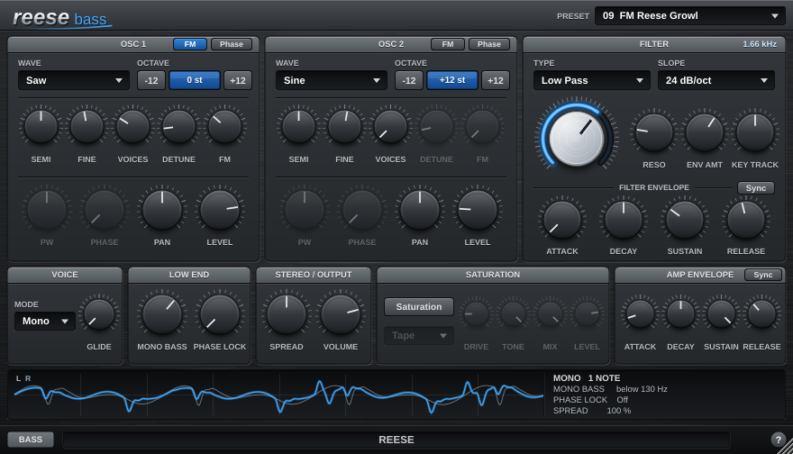

# Reese

A Reese bass instrument (VST3, Windows x64) in the Virus Delay family look. It has two detunable
oscillators with unison, controls to keep the low end mono and in phase, an analog-style multimode
filter, and the KickDrum saturation.



## Download

Every push to `main` builds the plugin on GitHub Actions:

* **Actions** tab > latest *Build and test* run > artifact **Reese-VST3-Windows-x64**, or
* the `builds-windows` branch: `Reese-VST3-Windows-x64.zip`.

Unzip and copy `Reese.vst3` to `C:\Program Files\Common Files\VST3`, then rescan in your DAW.
It appears as an instrument under **VirusDelay Project**.

## Oscillators (x2)

* **Wave**: Saw, Ramp (reverse saw), Square, Pulse, Triangle, Sine, Saw + Square, Noise.
  All are band-limited (PolyBLEP / PolyBLAMP), so they stay clean high up and with wide detunes.
* **-12 / +12** buttons beside each oscillator shift it down or up an octave (-36 to +36 semitones).
* **Semi** (-12 to +12) and **Fine** (-100 to +100 cents). Fine is the classic Reese detune between the two oscillators.
* **Voices** (1-8) and **Detune** (0-100 cents): a unison stack spread symmetrically across +-Detune
  and fanned out across the stereo field.
* **PW** (Pulse wave), **Phase** (start phase when retriggered), **Pan**, **Level**.

## Low end

* **Mono Bass** (Off-200 Hz): everything below this frequency is summed to mono (Linkwitz-Riley 24 dB/oct
  crossover, so the split is flat). It runs after the stereo spread, so the lows stay mono even at 200 %.
* **Phase Lock** (Off-200 Hz): below this frequency the oscillators are retriggered on each note and kept
  in phase, so the sub never beats or cancels. Above it you still get all the detuned Reese movement.
  How it works: each voice also runs one coherent copy of each oscillator (no detune or unison spread, phase
  reset at note-on). That copy supplies the band below the crossover, and the detuned stack supplies the band
  above it. A unit test checks that with two oscillators 50 cents apart on A1, the sub level swings about 8:1
  without the lock and stays within 1.1:1 with it.

## Voice

* **Mode**: Mono (retriggers the envelopes), Legato (glides without retriggering), Poly (8 notes).
* **Glide** (Mono / Legato), and **Retrig**, which restarts the oscillators at their Phase on every
  new note so every note starts the same way. If a still-sounding voice is restarted, it fades out over
  3 ms first, so the restart doesn't click.

## Filter

* Analog-style **Low Pass / Band Pass / High Pass**, **12, 24 or 36 dB/oct** (1-3 zero-delay-feedback
  state-variable stages with Butterworth spacing). Each stage saturates gently on its input and integrator,
  like an OTA filter, so high resonance stays round instead of whistling.
* **Cutoff** (20 Hz-20 kHz) and **Reso** move smoothly with no steps. The cutoff is smoothed and
  recalculated every sample.
* **Env Amt** (+-96 semitones), **Key Track**, and a filter envelope (Attack, Decay, Sustain, Release).

## Saturation, stereo and output

* **Saturation**: the KickDrum design. Soft, Tape, Tube, Hard Clip, Foldback and Fuzz curves, with Drive,
  Tone, Mix and Level. It is 4x oversampled with linear-phase filters, and the latency is constant and
  reported to the host.
* **Spread**: fully left is mono, centre is 100 %, fully right is 200 % (mid/side width).
* **Volume**, and an **Amp Envelope** (Attack, Decay, Sustain, Release).

## Envelope sync

Both envelopes (Filter and Amp) have a **Sync** button. With Sync on, Attack, Decay and Release lock to note
values at the host tempo (120 BPM if the host gives none): **1/512, 1/256, 1/128, 1/64, 1/32, 1/16, 1/8, 1/4,
1/2, 1/1** (1/1 = one bar of 4/4). Each knob step moves one note value, and the tooltip shows the time in ms at
the current tempo. Sustain stays a level. Switching Sync off goes back to the free times, which are kept.
* Signal flow: voices -> saturation -> stereo spread -> mono bass -> volume.

## Controls

* Every knob moves in steps of **1.0** when you drag or use the mouse wheel. Hold **Shift** for **0.1** steps.
  Cutoff and Reso are the exception and move continuously. Double-click a knob to reset it, and hover
  to see its value in real units.
* The window is resizable from the bottom-right corner (70-200 %) and remembers its size.
* 9 factory presets.

## Building

Requirements: CMake 3.22+, Visual Studio 2022. JUCE 9.0.4 is downloaded automatically
(or pass `-DJUCE_DIR=/path/to/JUCE`).

```
cmake -B build -A x64
cmake --build build --config Release --target Reese_VST3
cmake --build build --config Release --target ReeseTests
build\ReeseTests_artefacts\Release\ReeseTests.exe
```

`ReeseTests --snapshot out.png [width] [preset]` renders the editor to a PNG without a display.
